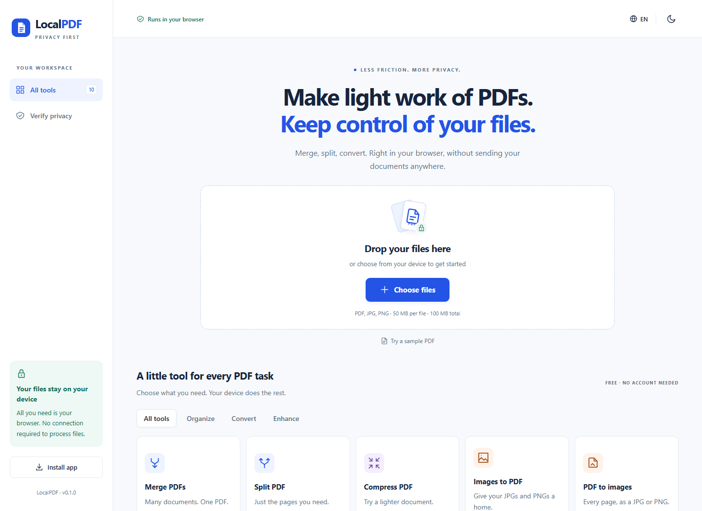

# LocalPDF

**Your Files. Your Device. Your Privacy.**

[Türkçe](README.md) · [English](README.en.md)



A free, open source PDF toolkit that processes documents in your browser. No account, paid API, processing server or database is required. LocalPDF is a static React/TypeScript application and an optional PWA.

## Tools

Merge, split, compress, reorder, rotate and remove PDF pages; convert JPG/PNG to PDF and PDF pages to JPG/PNG; add text watermarks and page numbers. Multiple outputs are packaged as a ZIP. Compression compares real output bytes; when no reduction is achieved, the original file is retained. Lossy image compression is optional and explicitly warns about losing selectable text and interactions.

## Run locally

Use the Node version in `.node-version` (Node 22.18+ is required).

```sh
npm ci
npm run dev
```

Production build and preview:

```sh
npm run build
npm run preview
```

The preview listens on `http://127.0.0.1:4173`. On Windows PowerShell, use `npm.cmd` if execution policy blocks `npm.ps1`; do not change system security settings.

## Verification

```sh
npm test
npm run check:repository
npx --no-install playwright install --with-deps chromium firefox webkit
npm run build
npm run test:e2e
npm audit --audit-level=high
```

Real PDF output, desktop/mobile Chromium workflows and offline processing have passed local tests. Firefox/WebKit verification and a known dependency warning remain open; see [VALIDATION.md](docs/VALIDATION.md) and [SECURITY.md](SECURITY.md) for the actual scope. CI is configured but has not run on GitHub yet. Test documents are generated synthetic fixtures, never user documents.

## Privacy and limitations

- Documents are processed in memory. There is no document upload endpoint, analytics or third-party runtime script.
- PDF work and ZIP generation run in dedicated workers. PDF.js rendering uses local workers, fonts, CMaps and WASM assets.
- The service worker caches application assets only. Language/theme preferences are stored locally; documents are not automatically persisted.
- Offline use needs an initial successful application cache. PWA installation is optional and browser-dependent.
- Previewing does not run document scripts, XFA, links or an annotation layer. This is not a complete PDF sanitizer or a security certification.
- Interactive forms, annotations, bookmarks and digital signatures are not preserved. Encrypted PDFs are rejected. Watermark text uses Helvetica/WinAnsi; some Turkish characters are unsupported. OCR and Office conversion are outside this release.
- Files are limited to 50 MiB each, 100 MiB total, 20 inputs and 300 PDF pages. See [ARCHITECTURE.md](docs/ARCHITECTURE.md) for further bounds.

## Screenshots, deployment and contribution

Eight actual application captures are in [docs/screenshots](docs/screenshots/README.md). They contain only synthetic documents. With a production preview running, `npm run screenshots` reproduces them in an isolated browser context.

[GitHub preparation](docs/GITHUB_PREPARATION.md) · [Cloudflare Pages setup](docs/DEPLOYMENT.md) · [Privacy test scope](docs/PRIVACY_TESTS.md) · [Contributing](CONTRIBUTING.md)

MIT licensed. Third-party notices are collected in `THIRD_PARTY_NOTICES.json` and included in production builds. This source folder is prepared for a new repository. Nothing is uploaded automatically.
