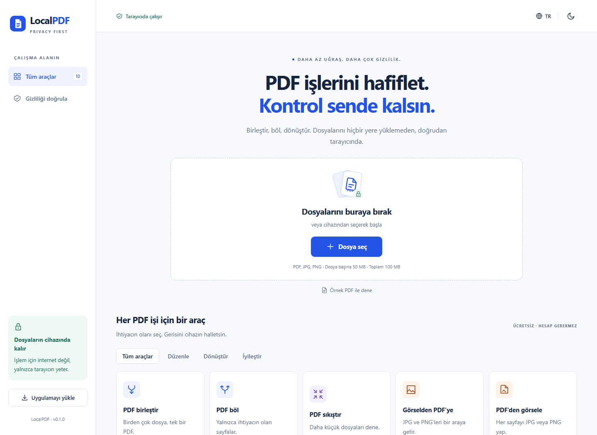

# LocalPDF

**Your Files. Your Device. Your Privacy.**

[Türkçe](README.md) · [English](README.en.md)



Ücretsiz, açık kaynak, tarayıcıda çalışan PDF araçları. Belgeleriniz işleme sunucusuna yüklenmez. Hesap, ücretli API veya veritabanı gerekmez. Web uygulaması ve isteğe bağlı PWA olarak kullanılır.

## Araçlar

PDF birleştirme, bölme, sıkıştırma, sayfa sıralama, döndürme, sayfa silme, JPG/PNG → PDF, PDF → JPG/PNG, filigran ve sayfa numarası. Çoklu çıktılar ZIP olarak indirilir. Sıkıştırma gerçek bayt boyutunu karşılaştırır; dosya küçülmezse özgün dosya korunur. Kayıplı sıkıştırma isteğe bağlıdır ve metin/etkileşim kaybını açıkça bildirir.

## Başlatma

Önerilen Node sürümü .node-version dosyasındadır; Node 22.18+ gerekir. Proje klasöründe:

```sh
npm ci
npm run dev
```

Windows PowerShell npm.ps1 dosyasını engellerse npm yerine npm.cmd kullan. Sistem güvenlik ayarlarını değiştirmek gerekmez.

Üretim önizlemesi:

```sh
npm run build
npm run preview
```

Adres: http://127.0.0.1:4173/ — terminalde sunucu çalışıyor olmalıdır.

## Doğrulama

```sh
npm test
npm run check:repository
npx --no-install playwright install --with-deps chromium firefox webkit
npm run build
npm run test:e2e
```

Gerçek çıktı ve gizlilik testlerinin sonuçları ile sınırları [doğrulama kaydında](docs/VALIDATION.md) bulunur. GitHub Actions yapılandırılmıştır; yerel doğrulama GitHub CI'nın çalışmış olduğu anlamına gelmez. Bu sürümde bilinen bir fflate bağımlılık uyarısı [SECURITY.md](SECURITY.md) içinde açıklanır.

## Gizlilik ve sınırlar

- Belgeler bellekte işlenir; dosya yükleme endpoint'i, reklam veya analitik yoktur.
- PDF ve ZIP işlemleri worker'da çalışır. PDF.js worker, font, CMap ve WASM varlıkları yerel derlemede bulunur.
- Service worker yalnızca uygulama varlıklarını önbelleğe alır. Belgeler varsayılan olarak kalıcı tarayıcı depolarına yazılmaz.
- Offline kullanım ilk başarılı önbellek kurulumundan sonra mümkündür. PWA kurulumu zorunlu değildir.
- PDF önizlemesi belge betikleri, XFA veya etkileşim katmanını çalıştırmaz. Bu bir PDF dezenfeksiyon ürünü veya güvenlik sertifikası değildir.
- Formlar, açıklamalar, yer imleri ve dijital imzalar korunmaz. Şifreli PDF'ler açık hata ile reddedilir. Filigranda Helvetica/WinAnsi karakter sınırı vardır.
- Dosya başına 50 MiB, toplam 100 MiB, 20 dosya ve 300 PDF sayfası sınırı vardır. OCR ve Office dönüşümleri bu sürümün kapsamında değildir.

## Görseller ve belgeler

[Sekiz gerçek ekran görüntüsü](docs/screenshots/README.md) yalnızca sentetik belgelerle çekilmiştir. Çalışan üretim önizlemesinde npm run screenshots ile yeniden üretilebilir.

[Belge dizini](docs/README.md) · [GitHub'a yükleme](docs/UPLOAD.md) · [Cloudflare Pages](docs/DEPLOYMENT.md) · [Mimari](docs/ARCHITECTURE.md) · [Gizlilik testleri](docs/PRIVACY_TESTS.md) · [Katkı](CONTRIBUTING.md)

## Lisans

[MIT](LICENSE). Üçüncü taraf lisans bildirimleri THIRD_PARTY_NOTICES.json içindedir ve üretim derlemesine eklenir. Bu klasör yeni bir depoya yüklenmek üzere hazırlanmıştır; herhangi bir hesaba otomatik olarak gönderilmez.
