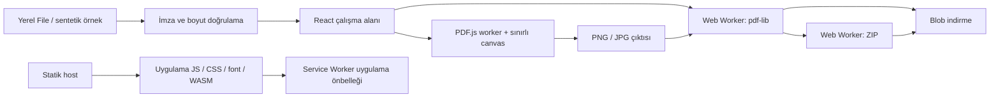

# Mimari

## Statik, tarayıcı içinde işleme

File verisinden statik hosta bir veri yolu yoktur. Host yalnızca uygulama varlıklarını sunar. Bu bir kaynak mimarisi açıklamasıdır; bağımsız test sonuçları [VALIDATION.md](VALIDATION.md) dosyasındadır.

## Sorumluluklar

- `src/pdf/contracts.ts`: format imzaları, görüntü boyutları, sayfa aralığı ve permütasyon doğrulaması, kaynak sınırları.
- `engine.ts`: adaptörden bağımsız pdf-lib işlemleri, yeniden oluşturma, gerçek çıktı boyutu karşılaştırması.
- `pdf.worker.ts`: işlem/inceleme/ZIP işlerinin sahipliği; iş bitiminde veya iptalde worker sonlandırılır.
- `client.ts`: aktarılabilir tamponlar, zaman aşımı, hata kodları, iptal.
- `render.ts`: PDF.js çalışma dosyası ve tüm font/decoder kaynakları yerel URL’lere bağlıdır; eval ve XFA kapalıdır.
- `raster.ts`: seri canvas çizimi; JPEG/PNG dışa aktarma ve kayıplı sıkıştırma. Görüntüleştirmede sayfa ölçüleri korunur; seçilebilir metin ve etkileşimler kaybolur.
- `Preview.tsx`: aynı anda en fazla 12 küçük resim; sadece canvas, PDF HTML’i/bağlantısı/betik katmanı yoktur.
- `App.tsx`: dosya önerileri, işlem durumu, erişilebilir kontroller, nesne URL yaşam süresi.

## Sınırlar

Dosya başına 50 MiB; toplam 100 MiB; 20 dosya; belge/çıktı başına 300 sayfa; çizim başına 12 milyon piksel ve 4096 kenar; çıktı 150 MiB; iş 120 saniye. Kayıplı sıkıştırma 20 sayfayla sınırlıdır. Kontroller bellek taşmasını kesin olarak engellemez: PDF sıkıştırılmış nesneleri açıldığında çok daha fazla bellek kullanabilir. Worker iptali, seri çizim ve küçük resim sayfalaması donma riskini azaltır. Canvas/Blob işlemleri ve PDF.js mesajlaşması nedeniyle tüm çalışma worker’da değildir.

PDF başlığı ve dosya uzunluğu tam PDF doğrulaması yerine geçmez; parser hata yönetimi ayrı katmandır. JPEG/PNG boyutları çözümlemeden önce okunur. Aralıklar tek tabanlıdır; yinelenen/out-of-bounds seçimler reddedilir. Dosya isimleri React metni olarak gösterilir; arşiv isimleri yol ayraçlarından temizlenir.

## Önbellek ve güncelleme

`finalize-build.mjs`, PDF.js kaynaklarını derlemeye kopyalar ve tüm dağıtım varlıklarının içeriğinden önbellek sürümü üretir. SW kurulumu, statik varlıkların `addAll` çağrısı tamamlanmadan başarılı sayılmaz. Bekleyen sürüm kullanıcı seçimine kadar etkinleşmez. Mevcut sekmede dosyalar varken güncelleme düğmesi devre dışıdır. Başka sekmeler varsa eski varlık önbellekleri tutulur; aksi halde eski uygulama önbellekleri temizlenir. Tarayıcı kendi depolama politikasıyla uygulama önbelleklerini silebilir.

SW yalnızca aynı origin’deki, açıkça listelenmiş GET varlıklarını kaydeder. Belgeler, sonuç Blob’ları ve POST içerikleri cache’e alınmaz. UI tercihi dışında kalıcı veri yazımı yoktur. Kullanıcının indirmeyi seçtiği çıktı tarayıcının normal indirme mekanizmasına bırakılır.

## Güven sınırı

CSP kaynak ve worker’ları aynı origin ile sınırlar. `wasm-unsafe-eval` yalnızca PDF.js WASM decoder derlemesine izin verir; JavaScript `unsafe-eval` yoktur. `style-src 'unsafe-inline'` React/canvas stil uyumu için izinlidir; belge HTML’i kullanılmaz. CSP bir parser açığını veya ele geçirilmiş aynı-origin uygulamayı güvenli hale getirmez. Bağımlılık incelemesi, güncellemeler ve HTTPS dağıtım güvenliği gereklidir.
